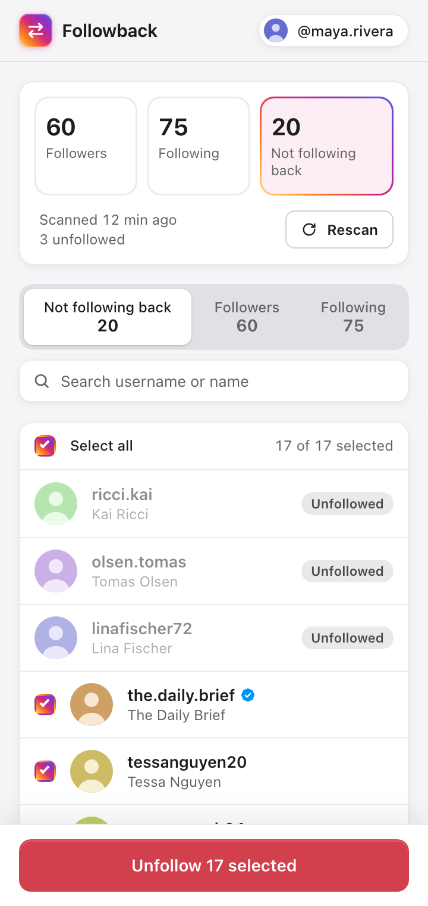
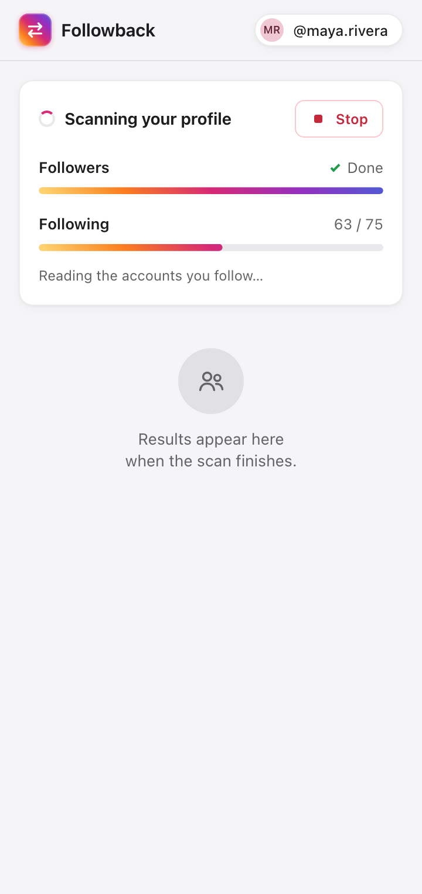
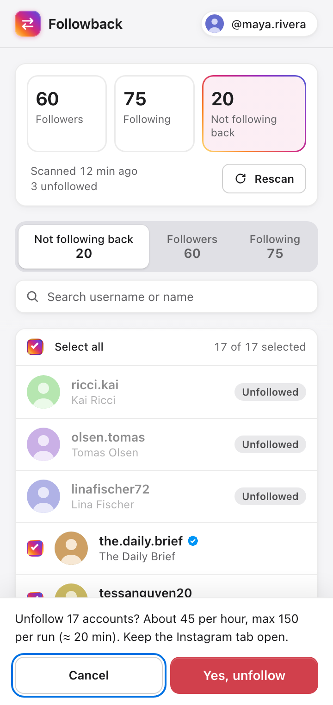
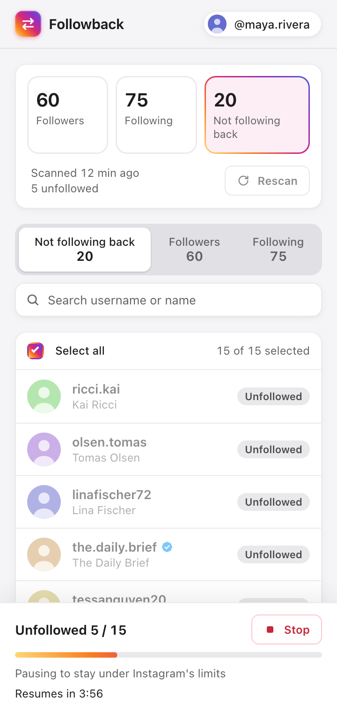

<p align="center">
  
</p>

<h1 align="center">Followback</h1>

<p align="center">
  See who doesn't follow you back on Instagram, and unfollow them at a pace Instagram tolerates.<br>
  A Chrome side-panel extension. No password, no API key, and your data never leaves your browser.
</p>

<p align="center">
  <picture>
    <source media="(prefers-color-scheme: dark)" srcset="docs/results-dark.png">
    
  </picture>
</p>

## Features

- **One-click scan** of your followers and following, run from your logged-in instagram.com tab.
- **Not following back** list with search, avatars and verified badges, plus full Followers and Following tabs.
- **Keep who you want.** Every account has a checkbox, so you can untick friends, brands or celebrities.
- **Safe bulk unfollow:** about 45 per hour, at most 150 per run. It stops at the first sign of rate-limiting.
- **Live progress** with a countdown during pauses, and a **Stop** button that works at any time.
- **Light and dark** themes.

## Install

Followback isn't on the Chrome Web Store, so you load it from source. You need Chrome 116 or newer.

1. Clone this repo, or [download it as a ZIP](https://github.com/svichas/followback/archive/refs/heads/main.zip) and unzip it.
2. Open `chrome://extensions` and turn on **Developer mode** (top right).
3. Click **Load unpacked** and select the `followback` folder.
4. Pin Followback from the puzzle-piece menu so its icon stays in the toolbar.

> If Instagram was already open, reload that tab once so the extension can talk to it.

## Use

<table>
  <tr>
    <td align="center"></td>
    <td align="center"></td>
    <td align="center"></td>
  </tr>
  <tr>
    <td align="center"><b>1. Scan</b></td>
    <td align="center"><b>2. Review and confirm</b></td>
    <td align="center"><b>3. Unfollow</b></td>
  </tr>
</table>

1. **Open your profile** at `instagram.com/<your username>` while logged in.
2. **Click the Followback icon.** The side panel opens next to Instagram.
3. **Click Scan followers & following.** It takes a minute or two per 1,000 accounts.
4. **Review the Not following back list.** Untick anyone you want to keep. Search finds people quickly.
5. **Click Unfollow N selected, then Yes, unfollow.** Keep the Instagram tab open until it finishes; it can sit in the background. You can click **Stop** at any time, and accounts already unfollowed stay marked.

## Limits and safety

Instagram blocks accounts that unfollow too fast, so Followback is deliberately slow.

| | |
|---|---|
| Between unfollows | a random 10–20 s |
| After every 5th unfollow | a 5-minute pause |
| Per run | at most 150, which takes about 3 hours. Run it again the next day. |
| When rate-limited | it stops right away and never retries an unfollow |

It also never unfollows anyone who follows you, and re-checks this right before each unfollow. A half-finished scan is never saved. Only one job runs at a time, across all your Instagram tabs.

## Troubleshooting

| You see | What to do |
|---|---|
| **Connect to Instagram** | Open instagram.com in the current tab. If it was open before you installed Followback, reload it. |
| **Instagram is rate-limiting your account (HTTP 429)** | Wait 15–30 minutes before scanning again, because retrying sooner tends to extend the block. Scan a few times a day at most. |
| **Instagram is limiting unfollows right now** | Stop for a few hours, ideally a day, then continue. Already-unfollowed accounts are remembered. |
| **Log in to Instagram in this tab first** | You're logged out. Log in, then try again. |
| **…sent this tab to a login or security check** | Complete Instagram's check on instagram.com, then try again. |
| **No totals while scanning** | Start the scan from your own profile page, because the totals are read from it. |

## Privacy

- **No password and no API key.** It uses the instagram.com session you're already logged in with, in that tab.
- **No servers and no analytics.** Your lists are stored only in `chrome.storage.local` on your computer.
- **Permissions:** `storage`, `sidePanel` and `unlimitedStorage`, plus a content script on `www.instagram.com`.

## How it works

```
side panel ──scan / unfollow──▶ content.js (your instagram.com tab) ──▶ Instagram's web endpoints
     ▲                                  │
     └──────── chrome.storage.local ◀───┘   progress, lists, unfollowed
```

`content.js` calls the same endpoints Instagram's web app uses: `/api/v1/friendships/…` to list accounts and `/web/friendships/…/unfollow/` to unfollow. It writes progress and results to `chrome.storage.local`, and the side panel only renders what's stored. Design notes and contracts are in [PLAN.md](PLAN.md).

## Development

There's no build step and there are no dependencies: it's plain Manifest V3 JavaScript.

```bash
node --test
```

| File | What it is |
|---|---|
| `manifest.json`, `background.js` | Extension shell; the toolbar icon opens the side panel |
| `content.js` | Scan and unfollow engine; runs on instagram.com |
| `sidepanel.html`, `sidepanel.css`, `sidepanel.js` | The UI |
| `test/content.test.js` | Engine tests, using Node's built-in test runner |

After editing, click **Reload** on Followback in `chrome://extensions`, then reload the Instagram tab.

## Disclaimer

Followback isn't affiliated with Instagram or Meta. It relies on undocumented web endpoints that can change without notice, and automated unfollowing is against Instagram's Terms of Use. Use it only on your own account, at your own risk.

## License

[MIT](LICENSE) © 2026 Stefanos Vichas
